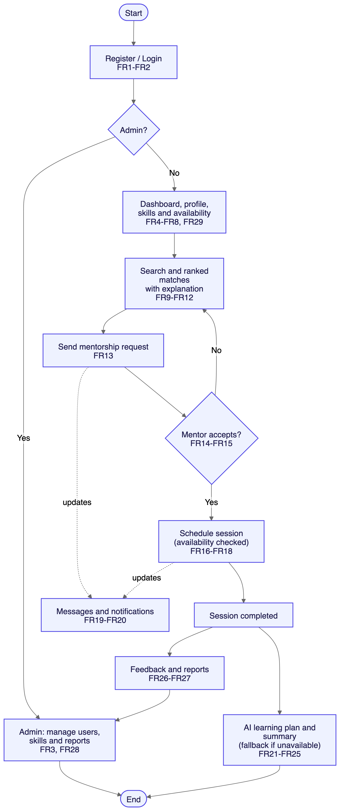
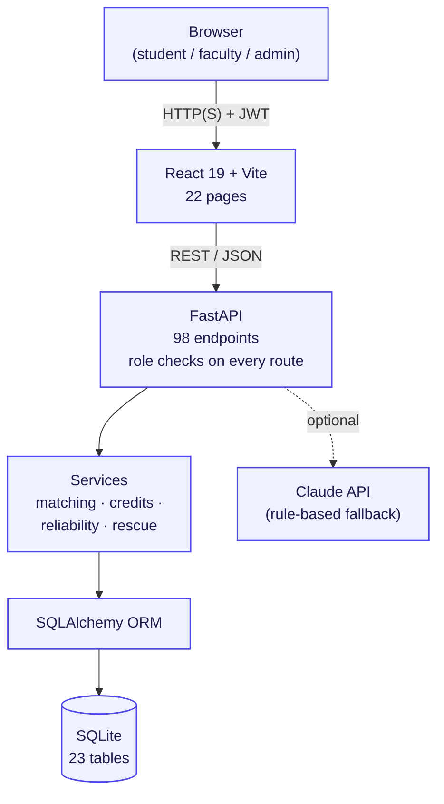

# Guildspace: Project Briefing

## 1. At a glance

**Guildspace** is a web platform that connects students who want to learn a skill with students who can teach it, and links that peer learning to the college's own faculty, courses and marks.

| | |
|---|---|
| **Project** | Community Skill Exchange and Mentorship Platform ("Guildspace") |
| **Course** | Software Engineering Lab |
| **Team** | Nehal Shah (2427030423), Tanishq Tiwari (2427030776) |
| **Tagline** | Learn from peers · Connect with mentors · Stay connected with faculty |
| **Source code** | github.com/Tanishqtiwari1/Guildspace |
| **Stack** | React 19 + Vite → FastAPI REST API → SQLAlchemy → SQLite |
| **Scale** | 98 API endpoints · 23 database tables · 22 pages · 9 automated API tests |
| **SRS coverage** | All 29 functional requirements (FR1–FR29) implemented |

**The rule we built to:** nothing on screen is hardcoded or fake. Every user, score, request, session, mark, credit and dashboard number is read from the database through the API, and changes made in the UI persist and immediately affect matching and dashboards.

## 2. The problem

Finding the right person to learn from is often as hard as learning the skill itself. Students already hold useful knowledge they could share, but skill exchange happens in scattered WhatsApp groups, social networks and unrelated apps. A learner has to work out, by hand, who knows the skill, who is free at the same time, and who is actually reliable.

At the same time, academic information (extra classes, notices, marks) lives in a separate world. A student who scores badly in a midterm has no easy way to find a classmate or senior who did well in that same course and is willing to help.

## 3. The solution

Guildspace brings both worlds into one place:

1. **Structured profiles.** Each student lists skills they can teach, skills they want to learn (with a goal and target level), weekly availability and preferred mode (online, offline or either).
2. **Explainable matching.** A compatibility score out of 100 ranks mentors, and every score comes with the reasons behind it.
3. **A complete mentorship workflow.** Request → accept → schedule inside both people's availability → message → confirm → rate and endorse.
4. **A faculty layer.** Verified faculty run courses, schedule extra classes, post targeted announcements and publish private marks.
5. **Trust and support.** Time credits, reliability scores, endorsements and Academic Rescue turn the platform from a directory into a system people can rely on.

## 4. Users and roles

| Role | Who | What they can do |
|---|---|---|
| **Student** | Any registered learner or mentor (one person can be both) | Profile and skills, find mentors, requests, sessions, messages, learning plans, credits, academics |
| **Faculty** | College teachers, **verified by an admin** before they can reach students | Courses and rosters, extra classes, announcements, marks entry and publishing |
| **Administrator** | Platform staff | Verify faculty, manage users and skills, review reports, view all records |

Roles are enforced on the server for every request. Hiding a button in the UI is never the only protection.

## 5. Core workflow

{width=50%}

*Figure 1. System flow, derived from the SRS (FR1–FR29).*

## 6. Feature summary

### Peer skill exchange

| Feature | Details |
|---|---|
| Accounts | Registration and login with bcrypt-hashed passwords and JWT tokens |
| Profile and skills | Skills offered (with proficiency) and needed (with goal and target level), weekly time slots, preferred mode |
| Search | By name, bio or skill; filter by mentor/learner, mode and location; ⌘K omnisearch |
| Matching | Ranked mentors and "learners I can help", each with a factor-by-factor breakdown |
| Requests | Pending → Accepted / Rejected / Cancelled / Completed; no self-requests; no duplicates |
| Sessions | Shared free slots are suggested; times outside either person's availability or clashing with another session are refused |
| Messaging | Private threads, available once a mentorship is accepted |
| Notifications | Every request, session, message, mark and announcement event |
| Feedback and reports | 1–5 rating after a session; report a user or issue to admins |
| AI assistance | Learning plans, session summaries and match explanations |
| Dashboard | Top match, next session, skill inventory, requests, academics feed, activity |

### Faculty and academics

| Feature | Faculty | Student |
|---|---|---|
| Courses | Create courses, add students by email or a join code, split into sections | Join with a code |
| Extra classes | Schedule, edit or cancel on a calendar; room and time clashes refused | Notified; shown on dashboard and calendar; add to schedule or download `.ics` |
| Announcements | Whole course, one section, or one student | See only what is addressed to them |
| Marks | Draft → publish (all or selected) → revise with confirmation → unpublish; every change audited | See **only their own published marks**, blurred until clicked |

### Trust and support (the unique layer)

| Feature | Details |
|---|---|
| **Skill credits** | 1 hour taught = 1 credit. Everyone starts with 2. Booking puts the learner's credits on hold; the mentor is paid only when **both** people confirm the session happened. Cancellations refund. |
| **Reliability score** | Share of sessions a person actually kept. Late cancellations (under 24 h) and no-shows count against them and reduce their match score. New users are never penalised. |
| **Endorsements** | After a confirmed session the mentor endorses the level the learner reached. |
| **Learning record** | A printable, peer-verified record of confirmed hours, skills, endorsements, rating and reliability. Never includes marks. |
| **Academic Rescue** | A student whose own published mark is below 50% is privately matched with classmates or seniors who took that course and volunteered to help, plus the next extra class and exam notices. Faculty see anonymous counts only. |

## 7. What makes Guildspace different

Most alternatives cover only one piece. YouTube and online courses teach, but don't connect you with a person at your college. Tutoring sites cost money and know nothing about your course. Group chats are informal and have no accountability. Learning management systems hold your marks but don't help you act on them.

Guildspace combines these, and its distinctive features come from the combination:

- **Academic Rescue links faculty marks to peer mentoring.** No outside platform knows which course you struggled in, who took it last year, or when the next extra class is.
- **Credits make the exchange fair.** Teaching earns the right to learn. Credits move only on two-sided confirmation, which discourages freeloading and fake sessions.
- **Reliability is built into matching.** People who keep their sessions rank higher; people who repeatedly cancel late or don't show up rank lower.
- **Every match is explained.** Users see exactly why someone was recommended, not an opaque "suggested for you".
- **Privacy by design.** Marks are visible only to the student and their faculty, enforced on the server.

## 8. How matching works

Each mentor gets a compatibility score out of 100, computed live from the database:

| Factor | Points | Rule |
|---|---|---|
| Skill offered | 25 | Mentor lists the skill |
| Level fit | 10 | Mentor's proficiency above (10) or equal to (5) the learner's target |
| Shared availability | 25 | Weekly overlapping minutes; 3 h/week earns full points |
| Interaction mode | 15 | Same mode 15; one side "either" 10; online vs offline 0 |
| Location | 10 | Same city 10; different city but both online 5 |
| Two-way exchange | 10 | Mentor wants to learn something the learner teaches |
| Reputation | 5 | Average session rating |
| Reliability | −10 to 0 | Penalty only, after 3+ tracked sessions with under 90% kept |

## 9. Architecture



**Main data entities (23 tables):** User, Skill, UserSkill, Availability, MentorshipRequest, MentorshipSession, Message, Feedback, Notification, Report, LearningPlan, FacultyProfile, Course, CourseEnrollment, ExtraClass, ExtraClassRSVP, Announcement, Assessment, StudentMark, MarkAudit, CreditTransaction, Endorsement, CourseHelpOffer.

The database can be swapped for PostgreSQL by setting one environment variable (`DATABASE_URL`). Existing databases are upgraded in place when new columns are added.

## 10. Security and privacy

- **Authentication:** bcrypt password hashing; signed JWT tokens that expire after 24 hours; the signing key is generated locally and never committed to Git.
- **Authorization on the server:** separate checks for student, verified faculty and admin; faculty can only touch courses they teach; users can only act on their own requests, sessions and records.
- **Marks privacy:** every student marks query filters on "this student" and "published". Asking for someone else's mark returns the same "not found" as a mark that doesn't exist. Notifications never include scores. Faculty Rescue insights are anonymous counts.
- **Faculty verification:** new faculty accounts can't reach students until an admin verifies them.
- **Input validation:** every request body is validated (lengths, ranges, time formats, academic year format, marks ≤ maximum).
- **Honest AI:** AI output is always labelled; when the AI service is unavailable the app says so and uses a rule-based generator built from the same data.

## 11. AI features

With an Anthropic API key configured, Guildspace uses Claude (`claude-opus-5-5`) to:

- turn a learning goal into a week-by-week **learning plan**, sized to the learner's real availability and mentor;
- turn session notes into a **summary** of topics, key points and next steps;
- write a plain-language **match explanation** from the scoring factors.

Without a key, all three features still work through rule-based generators that use the same database records, and the UI labels the output "Rule-based (AI unavailable)". Users can edit generated plans; nothing generated is presented as a guaranteed outcome (FR22, FR24, FR25).

## 12. Testing and quality

The backend has automated end-to-end API tests (`backend/tests`, run with `pytest`), all passing:

| Test file | What it proves |
|---|---|
| `test_workflow.py` | Registration rules, full request → session flow, availability and clash checks, feedback rules, admin moderation |
| `test_academics.py` | Faculty verification, course access control, extra classes and room clashes, section-targeted announcements, **marks privacy attacks** |
| `test_trust.py` | Credit escrow and refunds, two-sided confirmation, no-show reports, reliability penalty, endorsements, **Academic Rescue privacy** |

The frontend builds cleanly with Vite and passes linting. Main flows were also checked by hand in the browser at desktop and phone widths.

## 13. SRS traceability

| SRS requirement | Implemented in |
|---|---|
| FR1–FR3 Accounts and admin restriction | `routers/auth.py`, `auth.py` |
| FR4–FR8 Profile, skills, availability, mode | `routers/profile.py`, Profile page |
| FR9 Search | `GET /api/search`, Find Mentors → Search |
| FR10–FR12 Matching, score, explanation | `matching.py`, `routers/matches.py` |
| FR13–FR18 Requests and sessions | `routers/mentorship.py`, Requests and Sessions pages |
| FR19–FR20 Messages and notifications | `routers/communication.py` |
| FR21–FR25 AI plans, summaries, fallback, labelling | `ai_service.py`, `routers/ai.py` |
| FR26–FR28 Feedback, reports, administration | `routers/feedback.py`, `routers/admin.py` |
| FR29 Dashboard | `routers/dashboard.py`, Dashboard page |

Features beyond the SRS: the faculty and academics module, skill credits, reliability, endorsements and learning records, and Academic Rescue.

## 14. Running the project

```bash
cd backend && ./venv/bin/python seed.py --demo
./venv/bin/python -m uvicorn main:app --port 8000
cd web-frontend && npm install && npm run dev
```

Then open `http://localhost:5173`. All demo accounts use the password `demo1234`:

| Role | Email |
|---|---|
| Student | tanishq@demo.com, nehal@demo.com, rahul@demo.com, aditya@demo.com, priya@demo.com |
| Faculty | meera@demo.com (teaches CS201 Data Structures) |
| Admin | admin@demo.com |

**Suggested demo (about 5 minutes):**

1. As **Tanishq**, open Find Mentors: Aditya ranks first, with the reasons shown.
2. Request mentorship; as **Aditya**, accept and schedule a session inside the suggested shared slot (credits go on hold).
3. As **Meera**, schedule an extra class for CS201, then create MTE-1, enter marks, save as draft and publish.
4. As **Tanishq**, see the notification, the extra class on the dashboard, and the blurred mark that reveals on click.
5. Show Academic Rescue: a low mark leads to peers who took CS201 and offer help.

## 15. Limitations and next steps

- **Runs locally.** The app is not yet deployed; a public link would need hosting (for example Vercel for the frontend and Render or Railway for the backend).
- **SQLite** suits a prototype; a hosted version should move to PostgreSQL.
- **No email or SMS.** Notifications appear inside the app only.
- **No-show disputes** are not yet reviewable by admins; a false report can only be corrected manually.
- **AI is optional** and needs an API key; without one, the rule-based fallback is used.
- **The SRS document** describes FR1–FR29 only and should be updated to cover the faculty module and trust features.

## 16. Team

| Member | Registration No. |
|---|---|
| Nehal Shah | 2427030423 |
| Tanishq Tiwari | 2427030776 |

*Software Engineering Lab.*
